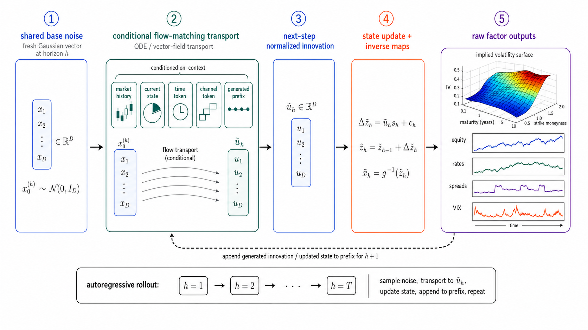
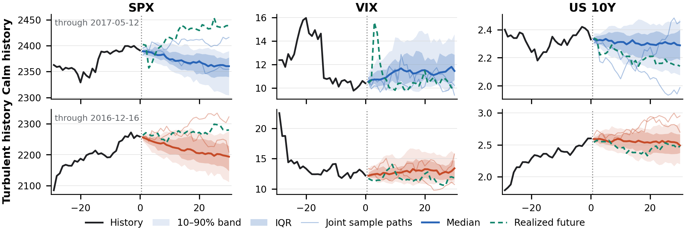
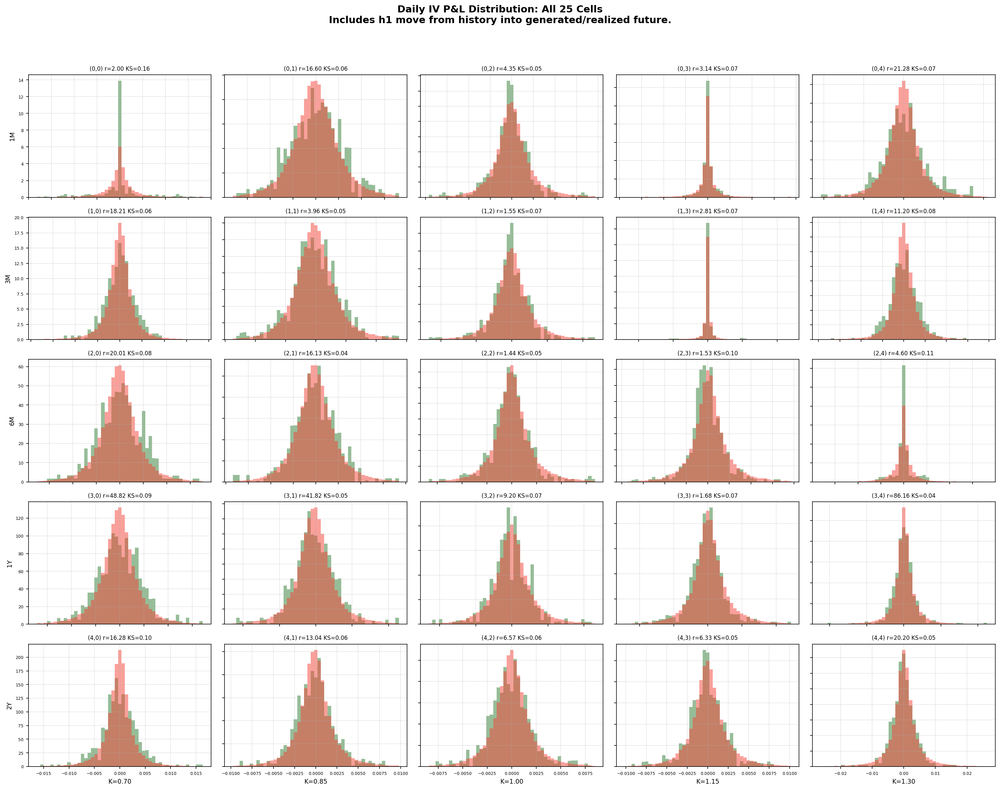
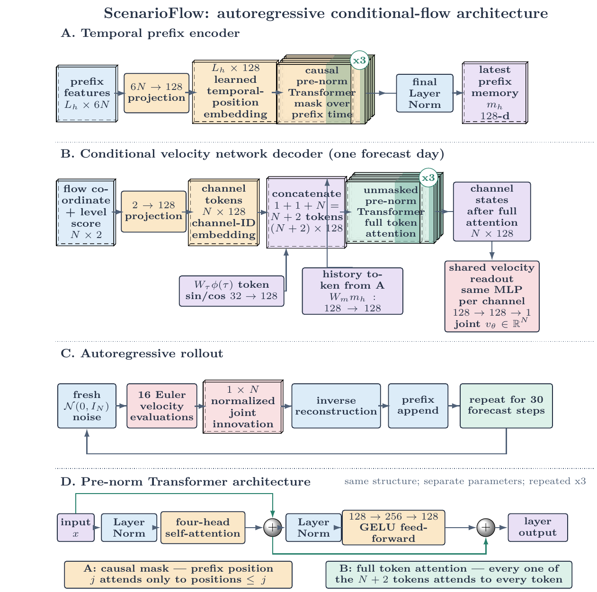

# ScenarioFlow

[](https://github.com/0xC000005/ScenarioFlow/releases)
[](LICENSE)
[](https://www.python.org/downloads/)
[](#quick-start)
[](https://github.com/users/0xC000005/packages/container/package/scenarioflow)
[](http://138.28.239.185:8767/)

ScenarioFlow is a temporal foundation model for generating conditional,
multivariate time series. Given numerical market history—or a natural-language
description through its language interface—it generates joint multi-day scenarios
across markets.

ScenarioFlow uses autoregressive flow matching to learn how variables evolve
together across time. This repository includes the model, adaptive-graph variant,
baselines, processed data, paper results, and two interactive demos.

**Live demo:** [http://138.28.239.185:8767/](http://138.28.239.185:8767/)

## Paper

**ScenarioFlow: Multimodal Market Conditioning for Heterogeneous Multivariate
Time-Series Simulation.** Jingwei Zhang, Patrick Ng, and Michael Andrushchenko.
NeurIPS 2026 Workshop on Foundation Models for Temporal Systems (FMTS).

- Paper: [camera-ready PDF](web/public/paper/ScenarioFlow_FMTS2026_paper.pdf)
- Code and results: this repository
- Archived copy of the code and model files: [OSF](https://osf.io/ywpc5/)

```bibtex
@inproceedings{zhang2026scenarioflow,
  title     = {ScenarioFlow: Multimodal Market Conditioning for Heterogeneous
               Multivariate Time-Series Simulation},
  author    = {Zhang, Jingwei and Ng, Patrick and Andrushchenko, Michael},
  booktitle = {NeurIPS 2026 Workshop on Foundation Models for Temporal Systems},
  year      = {2026}
}
```

Version 1.1.0 of this repository accompanies the camera-ready paper. It updates
the code, results, documentation, and website. The model weights and the
container image are unchanged from the
[v1.0.0 release](https://github.com/0xC000005/ScenarioFlow/releases/tag/v1.0.0),
which is where the setup script downloads them from.

## Requirements

- Linux with [uv](https://docs.astral.sh/uv/) and Python 3.11 or newer.
  `./scripts/setup.sh` creates the environment and downloads the released
  weights (about 11 MB for the core model).
- A GPU is optional. Inference and the checks below run on CPU.
- The interactive demo additionally needs Docker, an `OPENAI_API_KEY`, and a
  signed-in Codex CLI.

## How ScenarioFlow works



*ScenarioFlow repeatedly transforms fresh noise into the next joint market state,
appending each generated state to construct a complete multi-day scenario.*

## Quick start

Install the environment and fetch the released weights:

```bash
./scripts/setup.sh
./scripts/check_installation.sh
```

The released weights are used directly; this does not retrain the model. The
Stage 2 checkpoint is installed at
`artifacts/cache/models/core/stage2/best_model.pt`.

The first command takes a few minutes on a fresh machine. To draw a small set of
scenarios right away:

```bash
./scripts/run_inference.sh --max-windows 4 --samples 8
```

This writes `build/inference/scenarioflow/scenarios.npz`. Its `scenarios` array
has shape `(windows, samples, 30 days, 39 variables)` in market units, and its
`variables` array names the 39 columns: the 25 implied-volatility surface cells
followed by the 14 other market series.

To use the model from Python:

```python
import torch
from scenarioflow import load_model

model, checkpoint = load_model(
    "artifacts/cache/models/core/stage2/best_model.pt", torch.device("cpu")
)
print(model.cfg.history_len, model.cfg.future_len, model.cfg.n_cells)
```

[`src/scenarioflow/reproduction/inference.py`](src/scenarioflow/reproduction/inference.py)
shows the remaining steps: building the conditioning history from `data/`,
sampling, and converting the samples back to market units.

If automatic artifact download is unavailable, download
`scenarioflow-core-v1.0.0.zip` from the v1.0.0 release, extract it, and run:

```bash
./scripts/setup.sh --bundle-dir /path/to/extracted-core-bundle
```

## Example outputs

### Conditional joint scenarios



*Conditional joint paths for SPX, VIX, and US 10Y. Shaded regions show the
generated distribution, while individual lines show sampled scenarios.*

### Marginal distributions



*Generated IV-change distributions overlap the observed distributions across
all 25 maturity and moneyness cells.*

## Model architecture



ScenarioFlow has three main parts. A causal Transformer encodes the available
history into a prefix memory. A conditional velocity network combines that
memory with flow time and one token per variable to transform Gaussian noise
into the next joint innovation. The generated state is reconstructed in market
units, appended to the history, and used to generate the following day.

**Code map:**

- [Core model and temporal prefix encoder](src/scenarioflow/model.py)
- [Conditional velocity network](src/scenarioflow/_causal.py)
- [State representation and reconstruction](src/scenarioflow/state.py)
- [Stage 1 next-step training](src/scenarioflow/reproduction/train_next_step.py)
- [Stage 2 rollout fine-tuning](src/scenarioflow/reproduction/finetune_rollouts.py)
- [Numerical inference](src/scenarioflow/reproduction/inference.py)

The natural-language interface adds lightweight alignment modules that supply
multimodal context to the same frozen ScenarioFlow generator.

[Open the vector architecture diagram](paper_assets/figures/illustrations/scenarioflow-architecture.pdf).

## Run training using our data

Train the clean numerical core in two stages:

```bash
./scripts/train_next_step.sh --seed 1001
./scripts/finetune_rollouts.sh --seed 1001
```

Stage 1 writes to `build/training/stage1/`; Stage 2 starts from the released
Stage 1 checkpoint and writes to `build/training/stage2/`. Pass `--output-dir`
to either command to override its output location; Stage 2 also accepts
`--checkpoint` to override its starting checkpoint.

This is a single-seed model-training route. It is separate from both released-
checkpoint replay and the paper's full multi-seed benchmark below.

## Run inference

### Run ScenarioFlow inference

Numerical inference requires only the final Stage 2 weights and the packaged
market histories. Stage 2 is the final trained ScenarioFlow model; Stage 1 is
only the intermediate next-step training checkpoint. Fetch the final weights if
they are not already installed:

```bash
./scripts/setup.sh
```

Generate conditional 30-day joint paths from the numerical histories:

```bash
./scripts/run_inference.sh
```

The command uses the released ScenarioFlow sampler and writes its outputs to
`build/inference/scenarioflow/`. Pass `--checkpoint` or `--output-dir` to
override the released Stage 2 checkpoint or output location. It does not use
OpenAI or Codex.

With no options the command scores all 441 validation windows with 64 samples
each, which takes more than ten minutes on CPU and prints nothing until it
finishes. Pass `--device cuda` to use a GPU, or `--max-windows` and `--samples`
for a smaller run. `summary.json` lists the variable, metric, and screen names
alongside their values.

This is released-checkpoint replay: it does not retrain ScenarioFlow or any
comparison baseline.

## Reproduce the final multi-seed benchmark

The paper benchmark is a separate 141-node grid: three training seeds
(`1001`–`1003`), five sampling seeds (`2001`–`2005`), and the 12 final
candidates only. Install the optional GARCH dependency, then inspect the full
grid without launching compute:

```bash
uv sync --locked --extra baseline-classical
./scripts/reproduce.sh --dry-run --device cpu
```

Run one node together with its dependencies, or resume every incomplete node:

```bash
./scripts/reproduce.sh \
  --node-id eval:deepvar:train_1001:rollout_2001 \
  --model-root build/reproduction/models \
  --result-root build/reproduction/results \
  --device cuda

./scripts/reproduce.sh --resume-all \
  --model-root build/reproduction/models \
  --result-root build/reproduction/results \
  --device cuda
```

For a bounded local check, pass explicit limits such as
`--smoke-max-windows 1`, `--smoke-samples 2`, `--smoke-epochs 1`,
`--smoke-max-train-windows 2`, and `--smoke-max-val-windows 1`. These limits
change the workload and are not paper-result settings. Resume skips a node only
when every declared checkpoint/JSON/NPZ completion artifact can be loaded.

After a successful full `--resume-all` run, validated result and window-score
artifacts are aggregated under `build/reproduction/results/aggregate`. The
completion JSON names that directory. This semantic rerun output is not a
historical byte-identical artifact. Learned-model intervals use three trained
model means (each averaged across five sampling seeds), classical intervals use
five sampling-seed values. The stable outputs are `summary.json`, `summary.md`,
`per-run-metrics.csv`, `per-run-thresholds.csv`, and `metric-summaries.csv`.

The command graph comes from
`results/frozen/multiseed/command-dag.json`; clean commands dispatch installed
`scenarioflow` modules and never require the removed numbered experiment tree.
The original uncommitted window-score overlay is unavailable, so new runs are
semantically faithful but are not promised byte-identical to the historical
result bytes. See `reproduction/final-benchmark-provenance.json` for revisions,
data hashes, the protocol hash, and paper-name mappings.

### Run multimodal conditional inference

The narrative interface requires the language runtime and the same final Stage
2 weights:

```bash
./scripts/setup.sh
./scripts/setup.sh --profile nl-runtime
uv sync --locked --extra demo-server --extra demo-openai
uv run scenarioflow demo doctor
./scripts/run_demo.sh
```

Set `OPENAI_API_KEY`, install the Codex CLI, and sign in with `codex login`.
Then open `http://127.0.0.1:8766`. The narrative-to-scenario demo turns a
natural-language condition into a conditional distribution. The
scenario-to-narrative demo describes a numerical scenario. OpenAI and Codex are used only by the interactive demos.

## Paper results in this repository

| Paper item | Where it lives |
| --- | --- |
| Table 1, benchmark on 39 variables | `paper_assets/tables/golden/fmts-benchmark-*.tex`, from `results/frozen/benchmark/` |
| Table 2, dollar-liquidity example | `paper_assets/tables/golden/fmts-dollar-liquidity-*.tex`, from `results/frozen/dollar-liquidity/` |
| Multi-seed table (Appendix C.2) | `paper_assets/tables/golden/fmts-multiseed.tex`, from `results/frozen/multiseed/` |
| Target-disjoint rerun (Appendix C.3) | `paper_assets/tables/golden/fmts-causal-v1.tex`, from [`results/causal-v1/`](results/causal-v1/README.md) |
| Figures | `paper_assets/figures/` |

The tables and figures are stored as frozen results with checksums.
[Paper assets](paper_assets/README.md) explains how to verify them and how to
regenerate the ones that have a surviving generator. The benchmark can be rerun
from scratch with the commands in the previous section. The target-disjoint
rerun is released as results only; its data split and checkpoints are not part
of this release.

## Repository contents

- `data/`: five checksum-pinned processed market-data files.
- `src/scenarioflow/{model,state,reproduction}/`: extracted model, state, and
  numerical training and inference core.
- `src/scenarioflow/benchmark/`: compact final baseline, evaluation, execution,
  aggregation, and reporting layer.
- `artifacts/manifest-v1.tsv`: checksums and release paths for large external files.
- `paper_assets/`: final paper tables and figures, with reproduction modes.
- `results/`: frozen numerical results behind the paper tables.
- `web/`: source of the project website and interactive demo. To work on it
  outside Docker, run `npm ci` and `npm run dev` in `web/` (Node 22); the dev
  server proxies `/g1` and `/g2` to the two demo backends on ports 7860 and
  7861.
- `tests/`: data and public-release contract tests.
- `scripts/check_release.py`: secret, host-path, and file-size release checks.

## Verify the release contract

```bash
uv sync --locked --all-extras
uv run --all-extras pytest -q
uv run python scripts/check_release.py --all
```

Tests that replay the released checkpoints are skipped until
`./scripts/setup.sh` has fetched them.

## Docker

The published runtime image was built from the v1.0.0 release and supports
`linux/amd64` and `linux/arm64`:

```bash
docker pull ghcr.io/0xc000005/scenarioflow:v1.0.0
docker run --rm ghcr.io/0xc000005/scenarioflow:v1.0.0 scenarioflow --help
```

It uses the same package and commands as the native setup. Data and fetched
artifacts remain bind-mounted from the checkout. To run the full demo site,
build its runtime and frontend services with Compose:

```bash
docker compose build
OPENAI_API_KEY="$OPENAI_API_KEY" \
SCENARIOFLOW_CODEX_HOME="$HOME/.codex" \
docker compose up frontend narrative-to-scenario scenario-to-narrative
```

Open `http://127.0.0.1:8766`. Omit either backend from the `docker compose up`
command when its optional credential is unavailable.

## Databricks

Databricks uses a separate numerical GPU image:

```bash
docker build -f deploy/databricks/Dockerfile \
  -t <registry>/scenarioflow-databricks:<tag> .
```

The image runs the same training, inference, and reproduction scripts as the
native release. See the [Databricks deployment note](deploy/databricks/README.md)
for the push, deployment, and run commands.

## Licences

The code in this repository is released under the [MIT License](LICENSE). The
data and some model files come with their own terms:

- The files in `data/` are provided for research reproduction and remain
  subject to their providers' terms. See [DATA_SOURCES.md](DATA_SOURCES.md).
- The fine-tuned Moirai checkpoint and its sample arrays derive from a model
  released for non-commercial use only. See
  [THIRD_PARTY.md](THIRD_PARTY.md).
- The paper, poster, and explainer video under `web/public/` are copyright
  their authors and are not covered by the MIT License. The institutional
  logos shown in the website's story are trademarks of their owners.

See [Paper assets](paper_assets/README.md) for table and figure reproduction.
