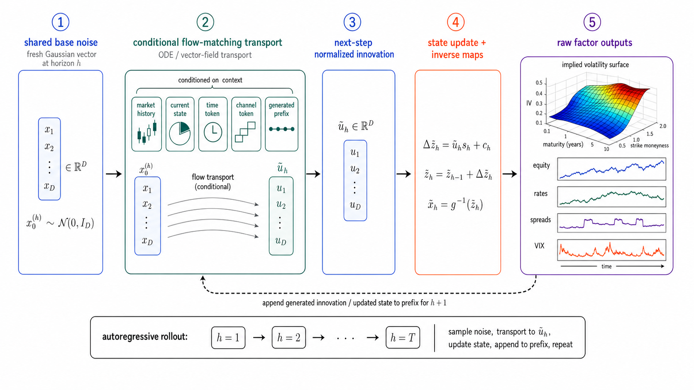
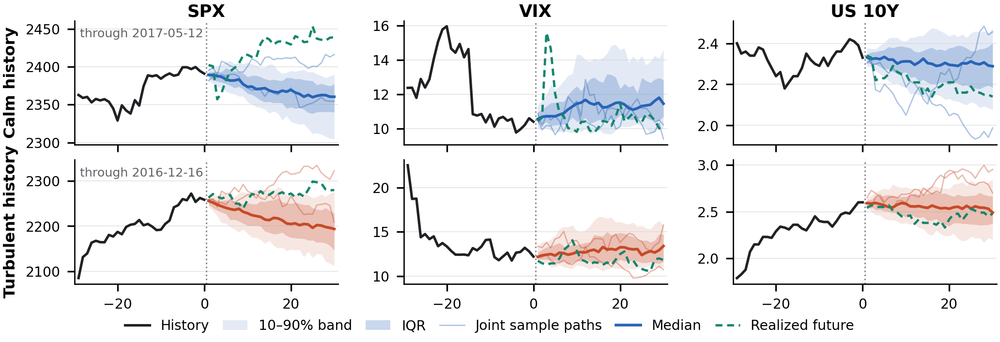
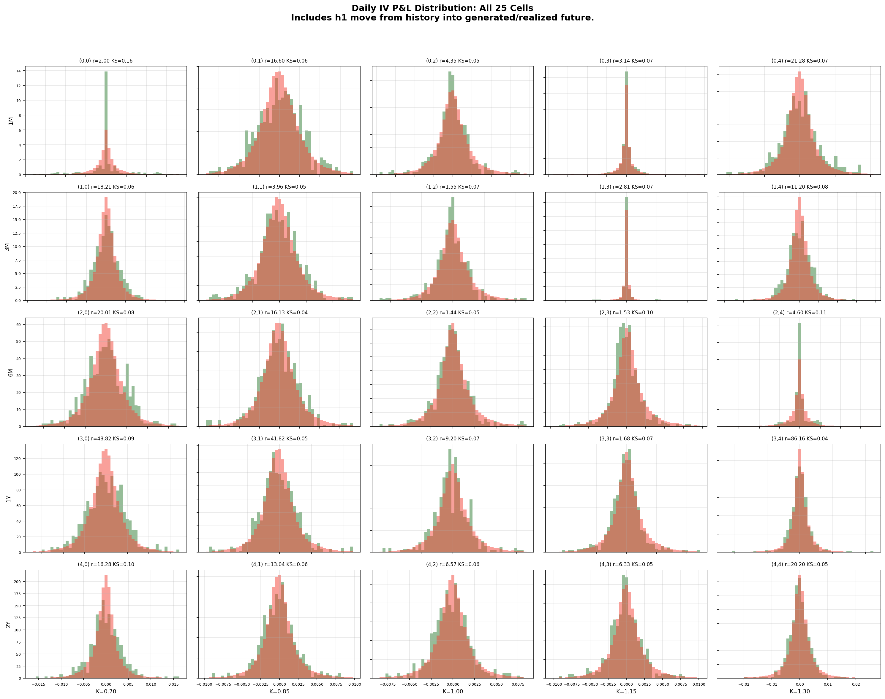
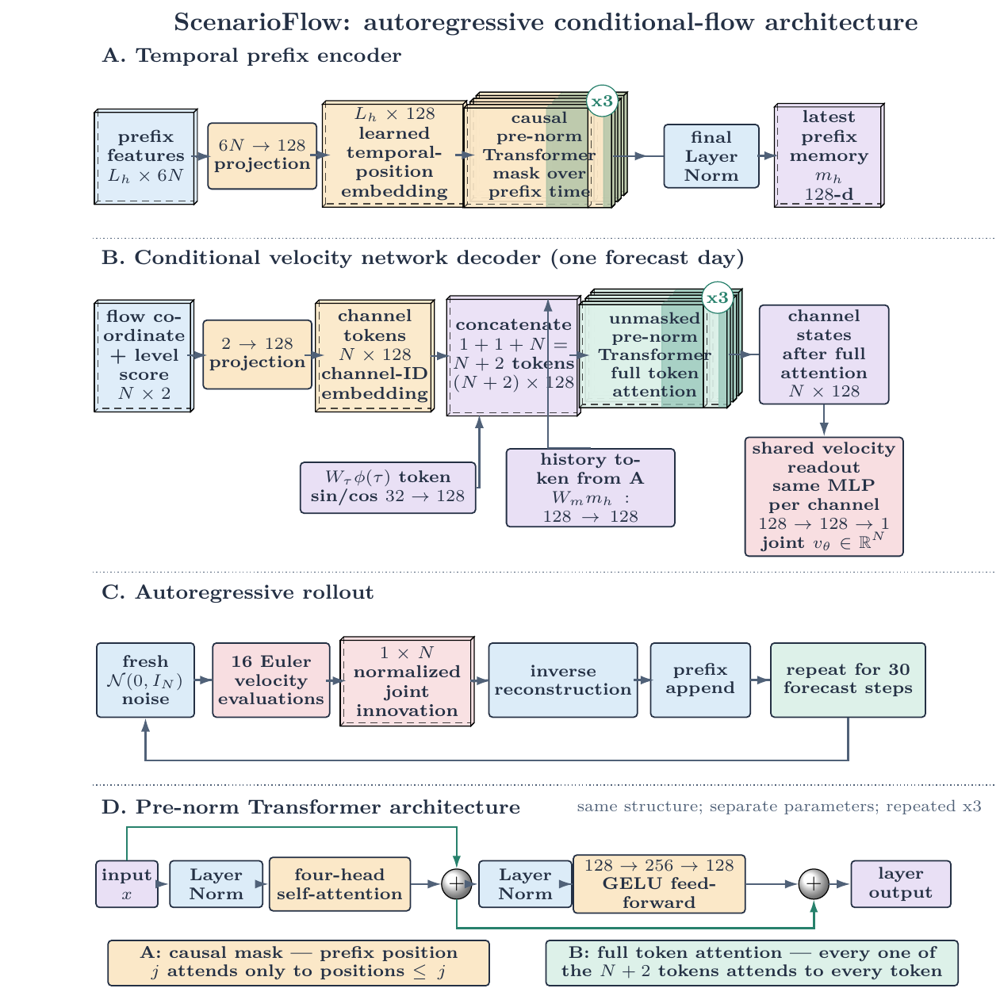

# ScenarioFlow

[](https://github.com/0xC000005/ScenarioFlow/releases)
[](LICENSE)
[](https://www.python.org/downloads/)
[](#quick-start)
[](https://github.com/users/0xC000005/packages/container/package/scenarioflow)
[](http://138.28.239.185:8766/)

ScenarioFlow is a temporal foundation model for generating conditional,
multivariate time series. Given numerical market history—or a natural-language
description through its language interface—it generates joint multi-day scenarios
across markets.

ScenarioFlow uses autoregressive flow matching to learn how variables evolve
together across time. This repository includes the model, adaptive-graph variant,
baselines, processed data, paper results, and two interactive demos.

**Live demo:** [http://138.28.239.185:8766/](http://138.28.239.185:8766/)

## How ScenarioFlow works



*ScenarioFlow repeatedly transforms fresh noise into the next joint market state,
appending each generated state to construct a complete multi-day scenario.*

## Quick start

Install the environment and fetch the released weights:

```bash
./scripts/setup.sh
./scripts/check_installation.sh
```

The released weights are used directly; this does not retrain the model. The
Stage 2 checkpoint is installed at
`artifacts/cache/models/core/stage2/best_model.pt`.

If automatic artifact download is unavailable, download
`scenarioflow-core-v1.0.0.zip` from the v1.0.0 release, extract it, and run:

```bash
./scripts/setup.sh --bundle-dir /path/to/extracted-core-bundle
```

## Example outputs

### Conditional joint scenarios



*Conditional joint paths for SPX, VIX, and US 10Y. Shaded regions show the
generated distribution, while individual lines show sampled scenarios.*

### Marginal distributions



*Generated IV-change distributions overlap the observed distributions across
all 25 maturity and moneyness cells.*

## Model architecture



ScenarioFlow has three main parts. A causal Transformer encodes the available
history into a prefix memory. A conditional velocity network combines that
memory with flow time and one token per variable to transform Gaussian noise
into the next joint innovation. The generated state is reconstructed in market
units, appended to the history, and used to generate the following day.

**Code map:**

- [Core model and temporal prefix encoder](src/scenarioflow/model.py)
- [Conditional velocity network](src/scenarioflow/_causal.py)
- [State representation and reconstruction](src/scenarioflow/state.py)
- [Stage 1 next-step training](src/scenarioflow/reproduction/train_next_step.py)
- [Stage 2 rollout fine-tuning](src/scenarioflow/reproduction/finetune_rollouts.py)
- [Numerical inference](src/scenarioflow/reproduction/inference.py)

The natural-language interface adds lightweight alignment modules that supply
multimodal context to the same frozen ScenarioFlow generator.

[Open the vector architecture diagram](paper_assets/figures/illustrations/scenarioflow-architecture.pdf).

## Run training using our data

Train the clean numerical core in two stages:

```bash
./scripts/train_next_step.sh --seed 1001
./scripts/finetune_rollouts.sh --seed 1001
```

Stage 1 writes to `build/training/stage1/`; Stage 2 starts from the released
Stage 1 checkpoint and writes to `build/training/stage2/`. Pass `--output-dir`
to either command to override its output location; Stage 2 also accepts
`--checkpoint` to override its starting checkpoint.

## Run inference

### Run ScenarioFlow inference

Numerical inference requires only the final Stage 2 weights and the packaged
market histories. Stage 2 is the final trained ScenarioFlow model; Stage 1 is
only the intermediate next-step training checkpoint. Fetch the final weights if
they are not already installed:

```bash
./scripts/setup.sh
```

Generate conditional 30-day joint paths from the numerical histories:

```bash
./scripts/run_inference.sh
```

The command uses the released ScenarioFlow sampler and writes its outputs to
`build/inference/scenarioflow/`. Pass `--checkpoint` or `--output-dir` to
override the released Stage 2 checkpoint or output location. It does not use
OpenAI or Codex.

### Run multimodal conditional inference

The narrative interface requires the language runtime and the same final Stage
2 weights:

```bash
./scripts/setup.sh
./scripts/setup.sh --profile nl-runtime
uv sync --locked --extra demo-server --extra demo-openai
uv run scenarioflow demo doctor
./scripts/run_demo.sh
```

Set `OPENAI_API_KEY`, install the Codex CLI, and sign in with `codex login`.
Then open `http://127.0.0.1:8766`. The narrative-to-scenario demo turns a
natural-language condition into a conditional distribution. The
scenario-to-narrative demo describes a numerical scenario. OpenAI and Codex are used only by the interactive demos.

## Repository contents

- `data/`: five checksum-pinned processed market-data files.
- `src/scenarioflow/{model,state,reproduction}/`: extracted model, state, and
  numerical training and inference core.
- `artifacts/manifest-v1.tsv`: checksums and release paths for large external files.
- `paper_assets/`: final paper tables and figures, with reproduction modes.
- `tests/`: data and public-release contract tests.
- `scripts/check_release.py`: secret, host-path, and file-size release checks.

## Verify the release contract

```bash
uv run pytest -q tests/test_release_contract.py
uv run python scripts/check_release.py --all
```

## Docker

The published runtime image supports `linux/amd64` and `linux/arm64`:

```bash
docker pull ghcr.io/0xc000005/scenarioflow:v1.0.0
docker run --rm ghcr.io/0xc000005/scenarioflow:v1.0.0 scenarioflow --help
```

It uses the same package and commands as the native setup. Data and fetched
artifacts remain bind-mounted from the checkout. To run the full demo site,
build its runtime and frontend services with Compose:

```bash
docker compose build
OPENAI_API_KEY="$OPENAI_API_KEY" \
SCENARIOFLOW_CODEX_HOME="$HOME/.codex" \
docker compose up frontend narrative-to-scenario scenario-to-narrative
```

Open `http://127.0.0.1:8766`. Omit either backend from the `docker compose up`
command when its optional credential is unavailable.

## Databricks

Databricks uses a separate numerical GPU image:

```bash
docker build -f deploy/databricks/Dockerfile \
  -t <registry>/scenarioflow-databricks:<tag> .
```

The image runs the same training, inference, and reproduction scripts as the
native release. See the [Databricks deployment note](deploy/databricks/README.md)
for the push, deployment, and run commands.

See [DATA_SOURCES.md](DATA_SOURCES.md) for the processed-data provenance and
[Paper assets](paper_assets/README.md) for table and figure reproduction, and
[LICENSE](LICENSE) for the repository license.
